# Invoice Ninja Cloud

## Overview

Connect your **hosted Invoice Ninja Pro or Enterprise company** from **MakeCrypto → Bookkeeping → Integrations**. MakePay adds a payment URL to each invoice, opens crypto checkout in that invoice's currency, and records confirmed payments back in Invoice Ninja.

You can keep using Invoice Ninja's hosted service. This connection uses its API and custom PDF/email templates. MakePay does not appear in the hosted service's built-in payment gateway selector.

For a self-hosted installation with a native client-portal gateway, use the separate [Invoice Ninja gateway guide](https://www.makecrypto.io/documentation/makepay/apps/invoice-ninja).

Repository and examples: [makepay-apps/makepay-invoice-ninja](https://github.com/makepay-apps/makepay-invoice-ninja). Start with the [Cloud guide](https://github.com/makepay-apps/makepay-invoice-ninja/blob/main/docs/CLOUD.md).

## Before you start

You need an Invoice Ninja plan with API access, an administrator API token for the company you want to connect, and an unused invoice custom field. Configure your MakeCrypto merchant's settlement settings first. Your invoice can use **USD, EUR or another supported invoice currency**; it does not need to match the settlement asset.

Complete any phone or sender verification Invoice Ninja requests before testing email delivery. Its [email customization guide](https://invoiceninja.github.io/docs/advanced-topics/email-customization) explains invoice, payment and reminder templates.

## 1. Create an Invoice Ninja API token

Open the correct company in Invoice Ninja. Go to **Settings → Account Management → Integrations → API Tokens**, click **New Token**, name it **MakePay**, and copy it securely.

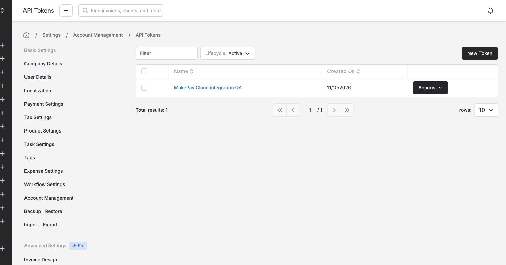

Treat this token as a company credential: it allows MakePay to read invoices, add payment URLs and record payments. Do not put it in an invoice template, browser URL or screenshot.

## 2. Connect from Bookkeeping

In MakeCrypto, select the merchant and open **Bookkeeping → Integrations → Invoice Ninja Cloud**.

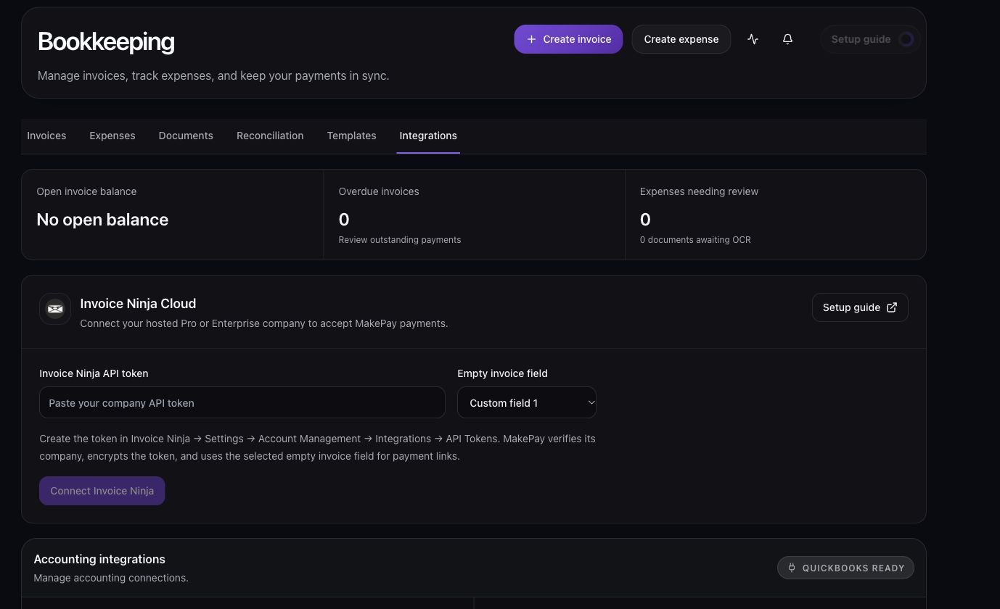

Paste the token, choose an **empty invoice custom field**, and click **Connect Invoice Ninja**. MakePay verifies the token's company, stores it encrypted, labels the selected field **MakePay payment URL**, and subscribes to invoice changes. The connected company name appears when setup succeeds.

Keep the selected field available for MakePay. Existing labels and invoice values in other fields are preserved. You do not need to replace your merchant's MakePay callback URL; this connector can coexist with Wix.

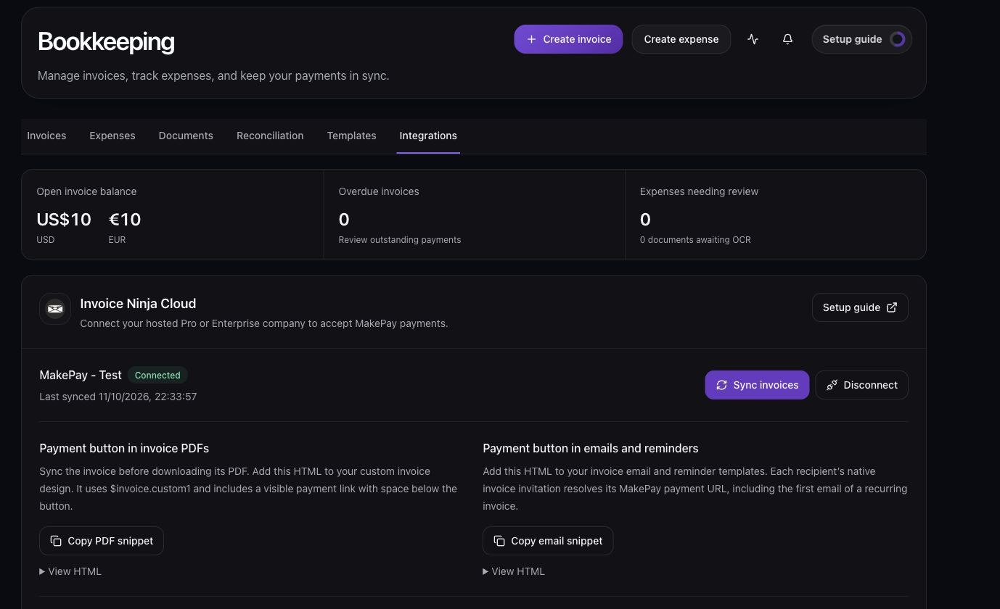

## 3. Sync and issue a test invoice

Click **Sync invoices**. Larger accounts import in pages; continue syncing while the page says an import is in progress. Background sync also picks up changes.

Create a clearly labelled test invoice in Invoice Ninja. Set the client's invoice currency, add an amount, and issue the invoice. Drafts receive a stable URL for PDF preparation but cannot collect payment until issued.

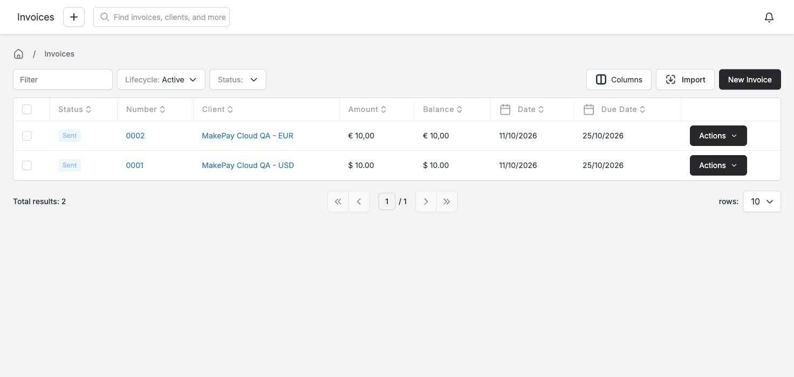

The invoice appears in Bookkeeping with **Invoice Ninja** as its source. Open its payment link: it goes directly to the standard MakePay checkout. Check the outstanding balance and currency there. Checkout uses the current balance fetched from Invoice Ninja, including partial payments.

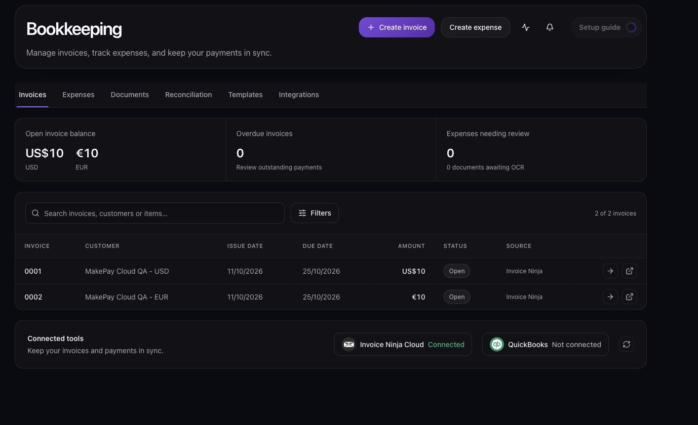

## 4. Add the payment button to PDFs

In the connected MakeCrypto panel, click **Copy PDF snippet**. It references the custom field selected for this company, such as `$invoice.custom1`.

In Invoice Ninja, open **Settings → Invoice Design → Custom Designs → New Design**. Name the design **MakePay invoice**, keep **Type: Design**, choose **Clean** as the starting design, and click **Save**.

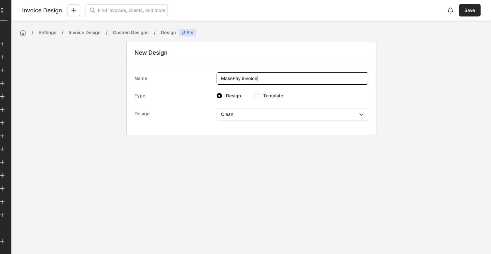

Open the saved design's **Settings** tab and enable **HTML Mode**. In **Body**, paste the PDF snippet immediately after the totals element, inside the same table cell. For the Clean design, that element is `
$status_logo
`. Keep the existing invoice HTML around it, then click **Save**.

Select your saved design in **Settings → Invoice Design → General Settings → Invoice Design**, or select it for an individual test invoice first.

Sync the invoice before downloading its PDF. Open the actual downloaded file and click **Pay with MakePay**. The snippet also prints a visible **Payment link** below the button, with space between them. Use that URL if the PDF viewer does not follow the button link. If the URL is absent, sync first and regenerate the PDF.

Changing a design affects newly generated PDFs. An older PDF will retain its earlier contents.

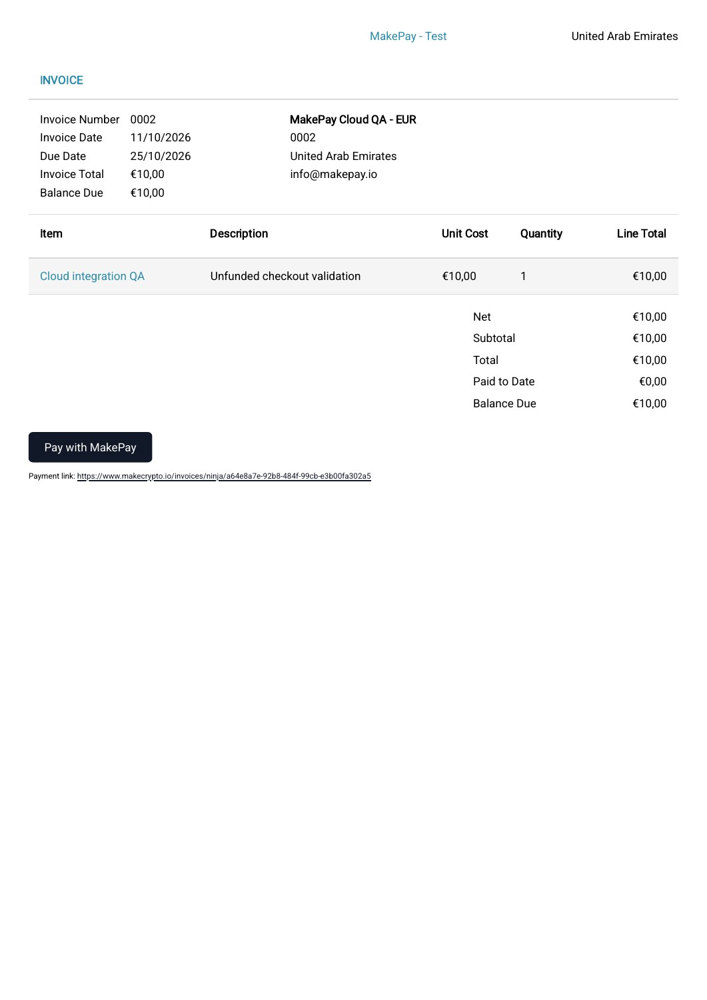

## 5. Add the button to invoice emails and reminders

Click **Copy email snippet** in MakeCrypto. Open **Invoice Ninja → Settings → Templates & Reminders → Invoice**. In the Body toolbar, click the document/code icon to open **Source Code**, append the snippet to your existing message, then click **Apply** and **Save**. Keep your existing subject and invoice variables.

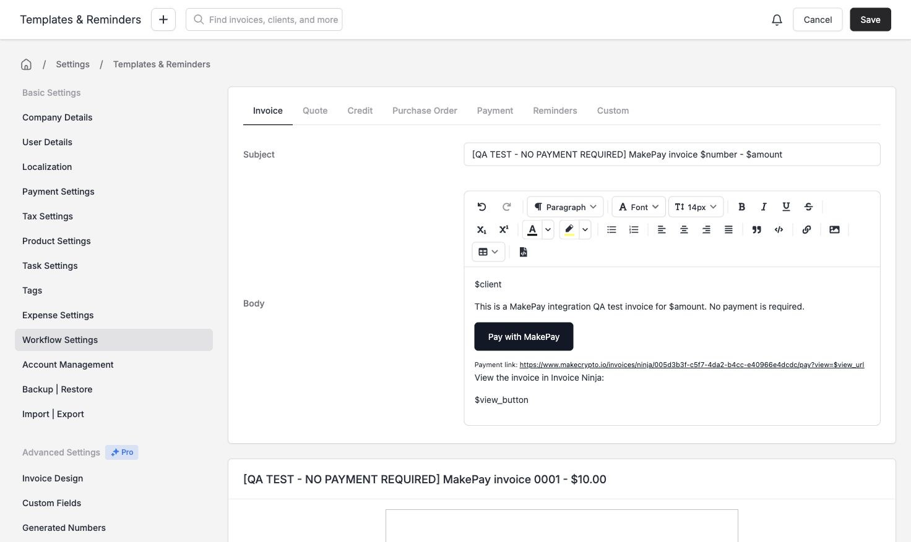

Open **Reminders → First Reminder** and repeat for each reminder template you use. Choose a reminder schedule and enable **Send Email** if you want it to run automatically. Adding a button to a template does not enable its schedule.

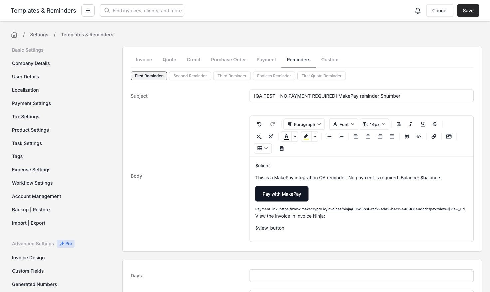

Use the **email snippet**, which includes Invoice Ninja's `$view_url` invitation variable. It resolves the recipient's invoice even when a new or recurring invoice email arrives before its first background sync. Keep Invoice Ninja's normal invoice-view link as a fallback.

Open **Settings → Email Settings**, enable **Attach PDF** if you want the custom invoice PDF included, and save.

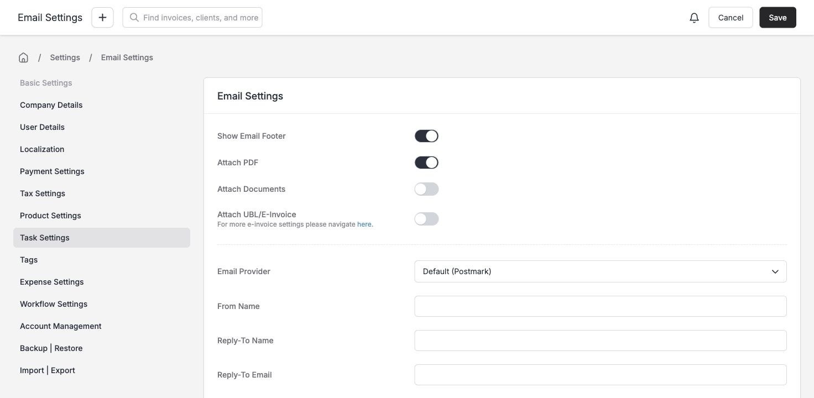

Open a test invoice's action menu and choose **Email Invoice**. Confirm its recipient, select **Initial Email** or **First Reminder**, review the preview, then click **Send Email**. Send to an inbox you control and check both received buttons and the attached PDF. Recurring invoices can use these links, but automatic crypto charging is unavailable.

## 6. Check payment confirmation

The email or PDF **Pay with MakePay** button opens the standard MakePay checkout directly. The customer chooses a payment asset and completes checkout. A browser redirect alone does not mark the invoice paid.

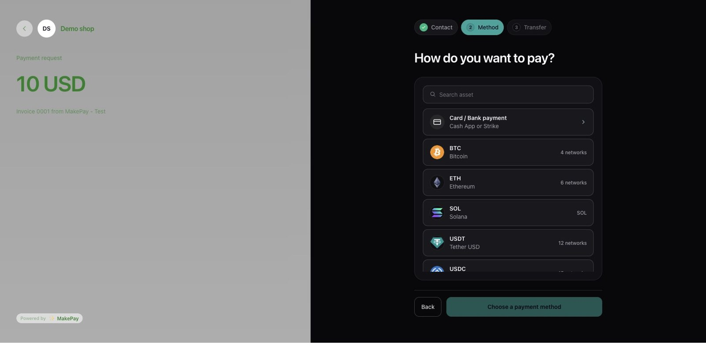

MakePay verifies its recorded settlement against the merchant, checkout, invoice currency and amount, then creates a Cryptocurrency payment in Invoice Ninja and allocates it to the invoice. Retry deliveries reuse the same payment reference. Allow a few minutes for background reconciliation; Bookkeeping displays **Recorded in Invoice Ninja** when it completes.

Invoice Ninja's normal payment notification settings control its receipt emails. Configure and test those settings separately from invoice and reminder templates.

## Troubleshooting

- **No Cloud gateway in Invoice Ninja:** connect through MakeCrypto Bookkeeping and use its PDF/email snippets. The self-hosted PHP installer cannot be uploaded to the hosted service.
- **Token rejected:** confirm the selected Invoice Ninja company, administrator permissions, API access and token status. Update the token through the connection form if it needs attention.
- **Custom field needs attention:** the selected field contains another value. Preserve it and reconnect with an unused field instead of overwriting business data.
- **Draft or closed invoice:** only issued invoices with an outstanding balance can create checkout. Deleted, archived, cancelled and paid invoices cannot collect payment.
- **Review required:** the client, currency or balance changed after checkout, or settlement could not be allocated safely. Review the payment before requesting another one.
- **Email blocked:** complete Invoice Ninja's phone/sender verification and check its delivery status. MakePay cannot bypass those requirements.
- **Disconnect:** open checkouts pause and payment URLs stop working. Reconnect the same company to restore its stable links and reconcile payments arriving later. Completed payments awaiting reconciliation must be resolved first.
- **Refunds:** handle the refund and record it manually in Invoice Ninja after checking settlement.

## Validation scope

The Cloud implementation has 22 focused connector and HTTP regression tests, including USD/EUR currency resolution, exact amounts, duplicate prevention, lost-response recovery, authenticated webhooks, disconnect protection, closed-invoice guards, direct checkout redirects, and recovery from the old form's `Origin: null` request. Migration checks cover row-level security, rate limits and concurrency leases.

Hosted QA verified real USD and EUR invoices, downloaded PDF link annotations, received invoice email links, and standard MakePay checkout amounts. Explicitly labelled, unfunded native API payment allocations verified both currencies and invoice-change webhook updates. These simulation records remain in the QA company audit history; the two checkout test invoices remain unpaid.

No crypto funds were transferred. These checks do not constitute a funded settlement test. Verify a controlled funded payment and its recorded Invoice Ninja balance before merchant rollout.
