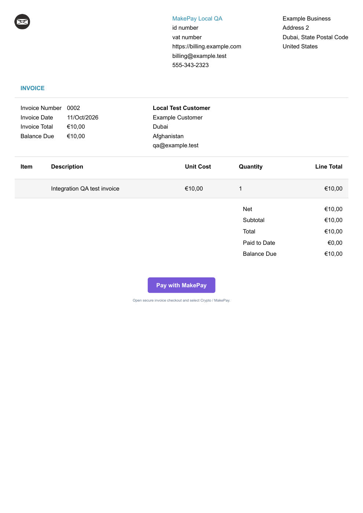
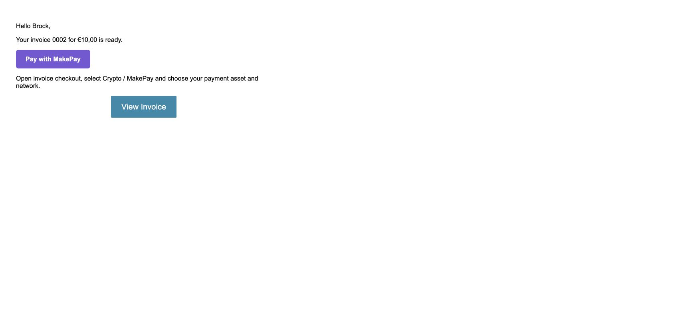

# MakePay buttons in invoice PDFs and emails

Invoice Ninja supports a clickable **Pay with MakePay** button in an invoice PDF, invoice email and reminder email. These examples use Invoice Ninja's invitation URL, so the customer opens the current invoice and selects **Crypto / MakePay**. They contain no API credentials and do not create a payment merely by opening an email or PDF.

## Invoice PDF

1. Open **Settings → Invoice Design → Customize & Preview** and copy your existing design to a custom design.
2. Insert [pdf-payment-button.html](../examples/pdf-payment-button.html) into the design's **Body**, after the invoice totals. If the design contains a closing `</body>`, insert the fragment before it.
3. Preview the design, save it and select it as your invoice design.
4. Download an unpaid invoice PDF. Click its button and verify that it opens that invoice in your public client portal. Choose Crypto / MakePay to continue.

Use a public HTTPS domain for Invoice Ninja's application URL. The native PDF sanitizer can remove links containing localhost/IP addresses or ports; our localhost preview used `https://billing.example.com` to verify the PDF link annotation. The sample domain is illustrative.

## Invoice emails and reminders

Open **Settings → Templates & Reminders**. Select the **Invoice** template and use [email-invoice.html](../examples/email-invoice.html) in its HTML/source editor, preserving any company-specific message you need. Use [email-reminder.html](../examples/email-reminder.html) in each reminder template you enable. Save and preview each template.

Configure reminder schedules in the same settings area. Configure your normal mail provider/SMTP transport in Invoice Ninja, and enable **Attach PDF** if you want the customized invoice PDF included with the email. Send a test invoice to an address you control and check both the HTML button and PDF attachment in the receiving mail client before sending to customers.

## Choosing the right native link

| Variable | Behavior |
| --- | --- |
| `$view_url` | Opens this invoice's client portal page. Used by our MakePay examples so customers can choose MakePay when several gateways exist. |
| `$payment_link` | Starts Invoice Ninja's instant-payment route using its first available gateway. Use it for a direct MakePay button only when MakePay is the first/only available gateway, and verify that ordering. |
| `$payment_button` | Invoice Ninja's styled payment button using the same instant-payment route. |

Keep invitation links private to the intended customer. Use the native variables rather than hardcoding an invitation or hosted checkout URL, so each invoice receives its own link and current balance.

## Payment receipts

Enable Invoice Ninja's **Online Payment Notifications** for the company/client and customize its **Payment** email template in Templates & Reminders. A verified completed MakePay callback creates a native payment; Invoice Ninja then queues its usual payment receipt. Duplicate callbacks do not queue another receipt. Pending or failed sessions do not send a paid receipt.

Payment email variables describe the payment, so `$view_url` in that template opens the payment receipt. Keep a receipt's action labeled **View payment** rather than presenting an already-paid invoice as a new MakePay checkout.

## Validation

The native test suite renders the invoice and reminder examples through `InvoiceEmailEngine`, processes the PDF fragment through `PdfService` and its sanitizer, and verifies one receipt queue job after payment completion and no second job after duplicate delivery. A real native PDF was rendered, visually inspected and checked for its clickable URI annotation. Local mail/queue fakes were used; delivery to an external mailbox has not been tested.

See Invoice Ninja's [email customization](https://invoiceninja.github.io/docs/advanced-topics/email-customization) and [advanced settings](https://invoiceninja.github.io/docs/user-guide/advanced-settings) documentation for the host application's settings.
