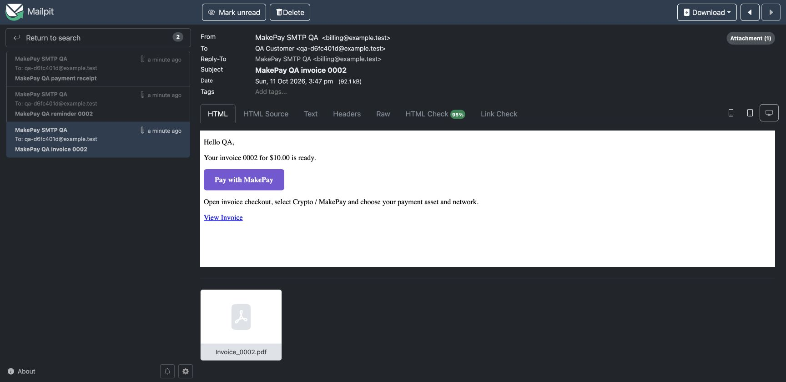
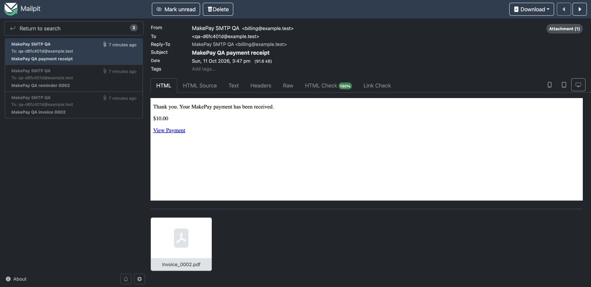

# Validation record

Recorded 2026-10-11. Candidate release: 1.0.0-rc.1.

## Upstream and environment

Invoice Ninja `v5-stable`, commit `f1ffa5f9989afbed4e7dc80b5c0cc18944335ffc`; PHP 8.5.5 locally, MySQL 8.4, Laravel's native client portal at localhost. The installer ran twice successfully without duplicate gateway registrations. CI uses PHP 8.4 and the same pinned upstream commit.

## Automated checks

`php tests/protocol.php`: 22 checks for HMAC verification, timestamp window, exact amounts and payment reference matching.

`php -d memory_limit=512M tests/integration.php /path/to/disposable/invoiceninja`: 38 native checks, including driver/settings discovery, merchant API connection-field serialization, client payment-method discovery, credential validation, server totals, persistent link reuse, native invoice/reminder HTML rendering, sanitized PDF design links and visible URL fallbacks, one-time receipt queueing, status filtering, stale signatures, wrong UID/amount/currency, company gateway binding, native payment allocation, duplicate delivery, HTTP routing, native fee quote, fee-inclusive partial payment and one-time fee recording. Requests to MakePay are mocked; the upstream models, MySQL transactions, fee calculations and payment service are real.

The HTTP endpoint was also exercised through the running Laravel server: an invalid signature returned 401 and a duplicate complete callback returned 200 `already_completed`. The native route is `/payment_webhook/{company_key}/{hashed_company_gateway_id}`; it is outside the `/api/v1` route group.

## Browser and real API checks

The real native portal offered Crypto, displayed the MakePay gateway screen, and redirected through the production MakePay API to hosted Demo Shop 2 checkouts displaying **10 USD** and **10 EUR**. A dedicated approved merchant QA key and signing secret were stored in encrypted gateway configuration. No secrets are committed or included in tutorial images.

A native custom invoice PDF containing the MakePay button was rendered, visually inspected and checked for its clickable URI annotation. Invoice and reminder HTML was rendered through the native email engine. Receipt queue behavior passed with mail/queue fakes and was then checked with actual local SMTP delivery. See [PDF/email setup](PDF-AND-EMAIL.md).

The native merchant application login succeeded, and **Configure Gateways → Create → MakePay** displayed all four credential fields. The installer stores the definition using the upstream JSON-string convention required by `GatewayTransformer`; this is covered by a regression check.

The QA credentials were also entered and saved through the native form. The real API credential check returned HTTP 200. Local Gotenberg PDF rendering verified that a localhost PDF hides the stripped button and retains the full visible URL; public-domain rendering retains clickable button/link annotations. The native Download PDF action was checked against the resulting downloaded file.

The Paid screenshot is from a local signed-callback simulation. The hosted-checkout screenshot is from the real API connection. No crypto was transferred. Localhost cannot receive Internet callbacks without a public HTTPS route; a funded payment and automatic provider delivery remain required before customer rollout.

## Native SMTP delivery and PDF attachments

Invoice Ninja's native invoice email, first reminder and payment receipt were delivered through SMTP to a loopback-only Mailpit 1.27.4 inbox. The disposable fixture used a **10 USD** invoice and synthetic `example.test` addresses; no external email was sent. MakePay API responses and the signed completed payment were simulated, while the native email jobs, SMTP transport and local Gotenberg PDF renderer ran normally.

| Delivered message | Downloaded attachment | PDF verification |
| --- | --- | --- |
| Invoice | 67,027 bytes | One page, $10.00, full visible invoice URL, two matching clickable URI annotations |
| First reminder | 67,027 bytes | One page, $10.00, full visible invoice URL, two matching clickable URI annotations |
| Payment receipt | 67,016 bytes | Valid one-page invoice PDF with two matching clickable URI annotations; receipt body shows $10.00 and **View Payment** |

The invoice and reminder **Pay with MakePay** buttons pointed to the correct native invitation URL. `https://billing.example.com` was used only to verify the public-domain link sanitizer; it is a reserved example domain, not a running merchant portal. The receipt uses the native payment URL. The native receipt attachment was labeled `application/octet-stream`, but its downloaded bytes were a valid PDF.

Replaying the completed callback returned HTTP 200 `already_completed`, created no additional payment and left exactly three delivered messages: invoice, reminder and **one** receipt. This verifies local SMTP delivery; delivery through a production mail provider to an external mailbox and a funded payment remain untested.

## Reproduce

Use a disposable local/testing Invoice Ninja application with its dependencies installed and database migrated/seeded. See `tests/ci.env` and the GitHub Actions workflow. Run the installer, protocol and integration checks. To create an unpaid browser fixture, pass `--portal-fixture` to the integration script; it prints an invitation URL. `output-fixture.json` is ignored and contains test references only.

The native automated suite now creates and completes an EUR invoice, preserving `fiatCurrency` independently of USDC settlement. It also rejects mismatched fiat amounts/currencies. Protocol checks cover zero and three decimal price precision.
