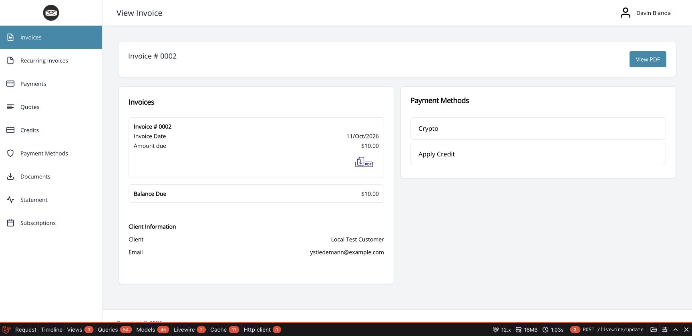
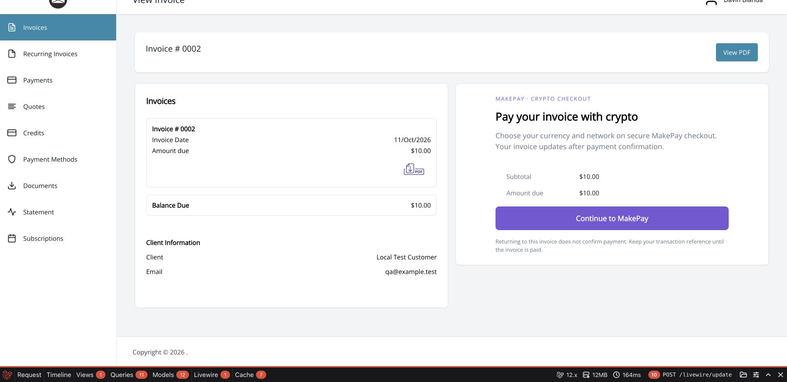
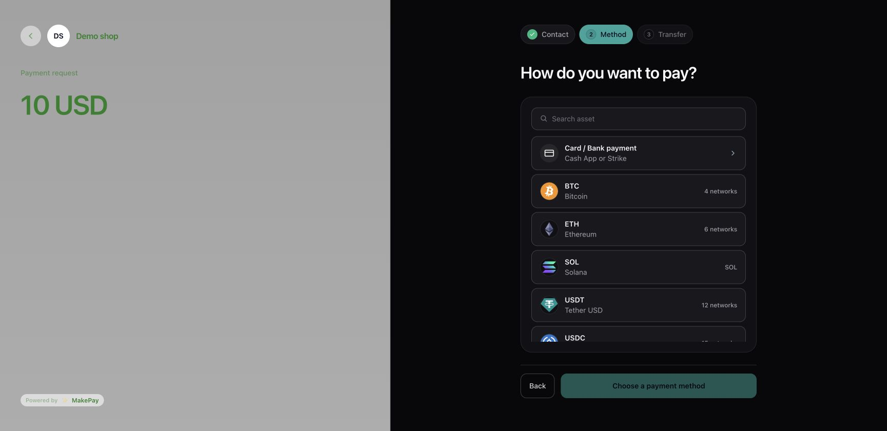
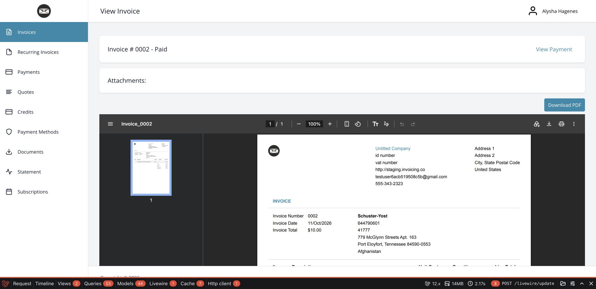

# Invoice Ninja merchant and customer walkthrough

Use self-hosted Invoice Ninja v5. The invoice currency is preserved in MakePay checkout. See the README for installation and the four encrypted gateway connection fields. Configure a stablecoin settlement route in MakeCrypto and set the company's callback to Invoice Ninja's native gateway webhook URL.

[Watch the captioned walkthrough](makepay-invoice-ninja-tutorial.mp4).

## Choose the native payment option

Open an unpaid invoice and choose Crypto. Invoice Ninja performs its normal contact/address checks before displaying the gateway.

## Review the payable amount

The MakePay screen shows Invoice Ninja's server-calculated total, including configured fees. Click **Continue to MakePay**. Browser-submitted amount and currency fields cannot override the server amount.

## Continue on hosted checkout

A real Demo Shop 2 API connection created this $10 USD payment link from the local Invoice Ninja portal. The customer chooses a supported asset/network on MakePay. A browser return alone does not confirm payment.

## Confirm through a signed callback

A complete callback must match the saved UID, payment hash, fiat amount/currency and company gateway. Invoice Ninja's native payment service allocates it to the invoice. The following **Paid** view comes from a local signed-callback simulation; no real funds were transferred.

For localhost, simulate signed callbacks against a disposable installation. A public HTTPS endpoint is needed for real provider delivery; `127.0.0.1` cannot receive Internet callbacks. Use separate merchant companies for Wix and Invoice Ninja when they need different default callbacks.

See [testing evidence](TESTING.md) for the exact upstream version, test commands and limits.
